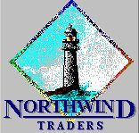
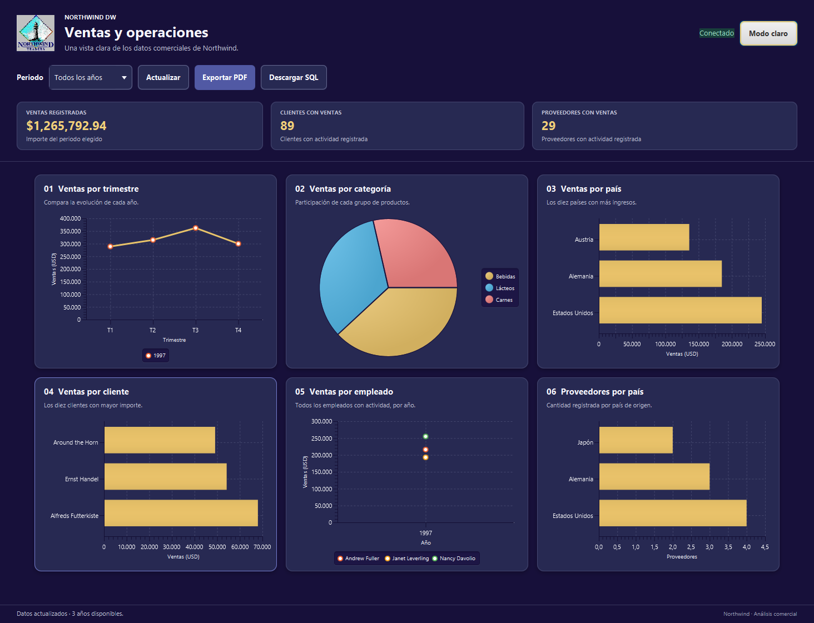
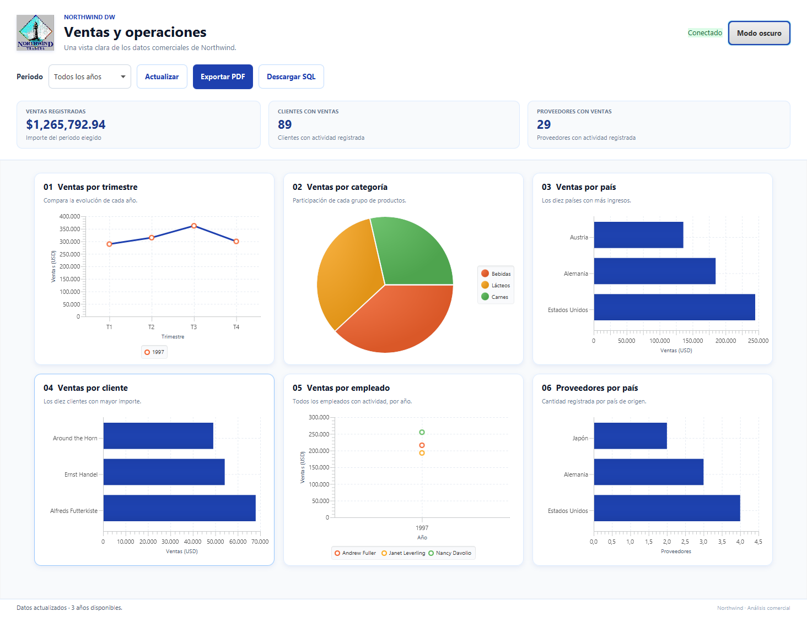
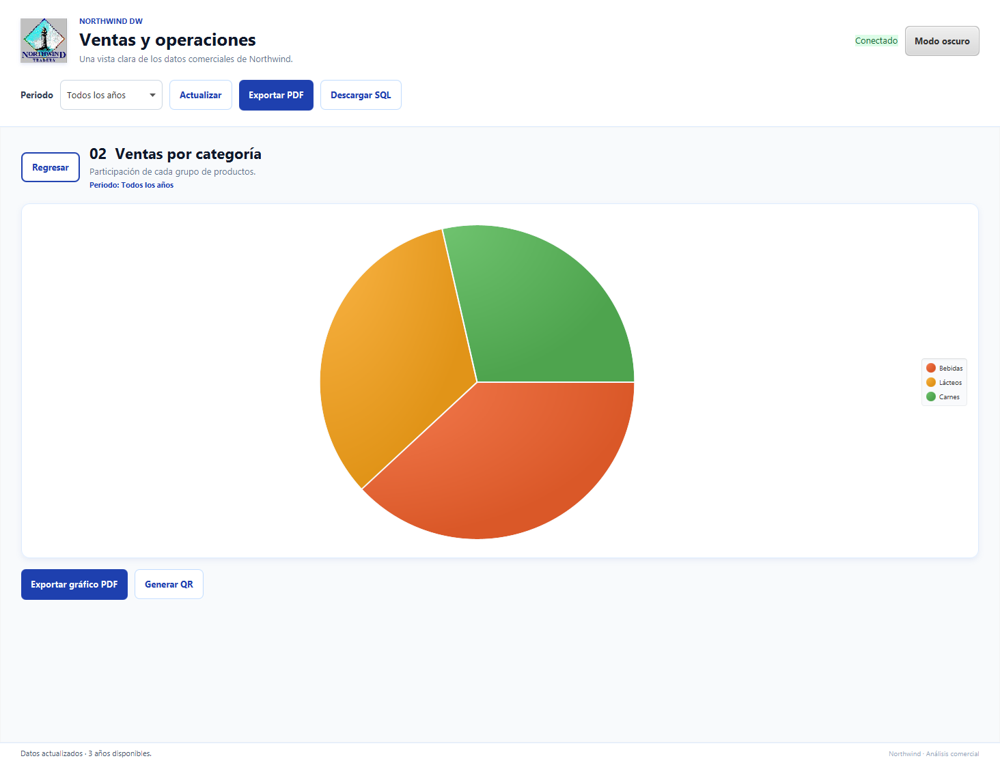
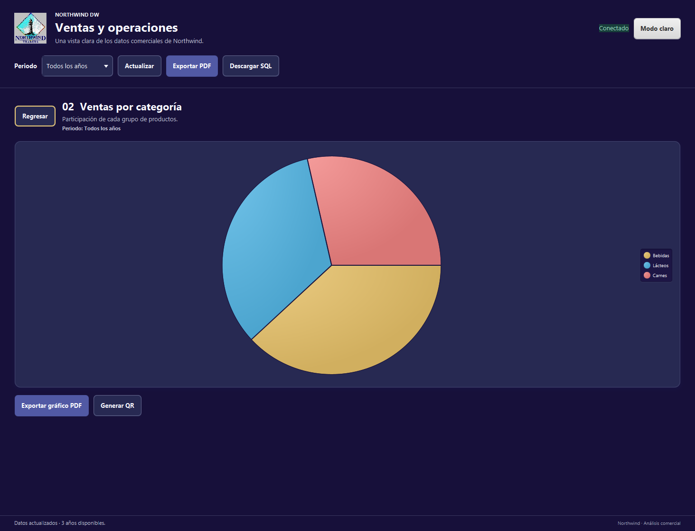
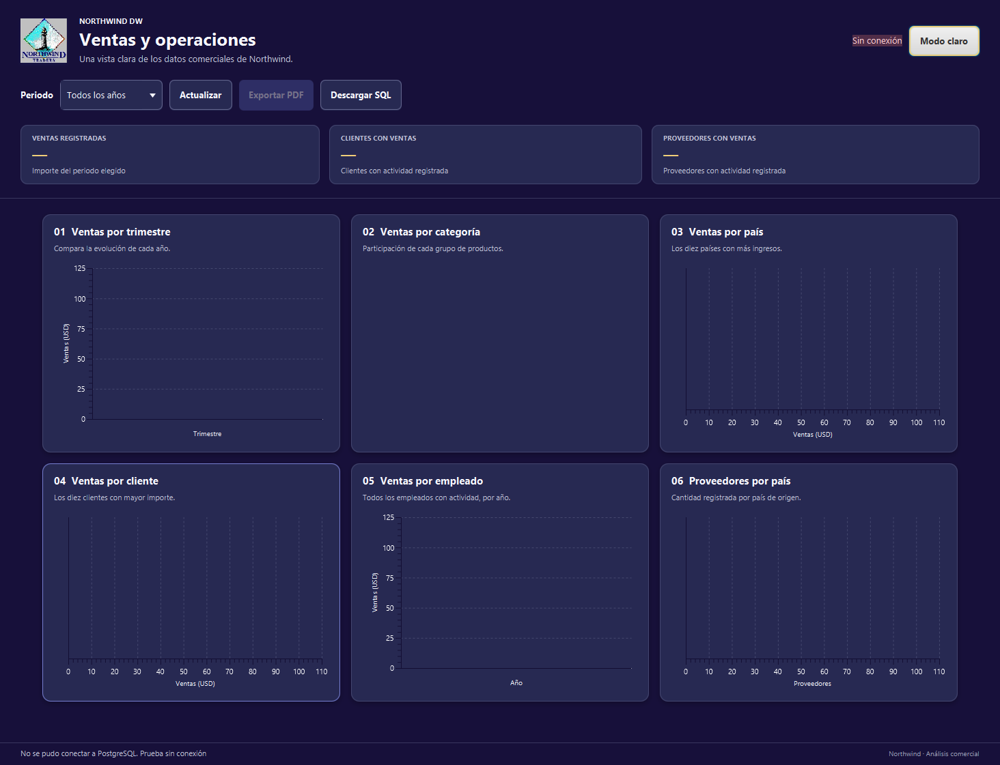

# Northwind DW

<p align="center">
  
</p>

Esta versión parte de un proyecto académico anterior que desarrollé. La idea original funcionaba, pero necesitaba mejor optimización y cuidado de seguridad; por eso tomé ese trabajo como base y preparé esta versión más pulida.

[Ver el video del sistema anterior](https://youtu.be/N9nk_wDomDY).

Northwind DW reúne los datos comerciales de ejemplo de Northwind en una ventana sencilla. Permite revisar las ventas a lo largo del tiempo, comparar productos, países, clientes y empleados, y consultar cuántos proveedores hay por país.

## Así se ve

Al abrirse, la aplicación usa el tema oscuro, con la paleta del proyecto original. Puedes cambiar a modo claro desde la esquina superior derecha; tu elección se conserva para la próxima vez. Las tarjetas se acomodan en tres, dos o una columna según el ancho de la ventana.

Las siguientes imágenes muestran ambos temas con valores de ejemplo:





Al elegir una tarjeta, puedes ver ese análisis a mayor tamaño. El detalle conserva los filtros y el tema, y permite regresar a la cuadrícula:





Si la aplicación no encuentra PostgreSQL, informa qué revisar y mantiene la ventana abierta:



## Qué incluye

- Ventas por trimestre y año.
- Participación de ventas por categoría de producto.
- Los diez países con más ventas.
- Los diez clientes con más ventas.
- Ventas de cada empleado por año.
- Cantidad de proveedores por país.
- Filtro por año, resumen de ventas y descarga de informes en PDF o del archivo para preparar la base.
- Detalle ampliado de cada gráfico, con una breve explicación y sus datos para el periodo elegido.
- Exportación del gráfico seleccionado a PDF, o creación de un código QR para descargar ese gráfico como imagen PNG en un teléfono.
- Modo claro y oscuro, con la elección guardada para el próximo inicio.
- Diseño que reorganiza las gráficas al cambiar el tamaño de la ventana.

## Preparar la aplicación

Necesitas Java 21, Maven y PostgreSQL instalados. El proyecto incluye los datos públicos de Northwind en `src/main/resources/db/northwind_dw.sql`.

1. En PostgreSQL, crea una base vacía llamada `northwind_pentaho`.
2. Carga `src/main/resources/db/northwind_dw.sql` en esa base. Si usas pgAdmin, abre la base, abre ese archivo en Query Tool y ejecútalo. La base debe estar vacía.
3. Conéctate a `northwind_pentaho` como administrador y ejecuta `src/main/resources/db/create_readonly_user.sql` una sola vez. En pgAdmin, asigna una contraseña al usuario `northwind_dw_app` desde **Login/Group Roles → Properties → Definition**. No escribas la contraseña en el archivo SQL.
4. En la carpeta principal del proyecto, crea tu configuración local copiando el ejemplo. En PowerShell:

   ```powershell
   Copy-Item .env.example .env
   ```

5. Abre `.env` y escribe el usuario `northwind_dw_app` y la contraseña que acabas de asignarle. Si tu instalación usa otro puerto o nombre de base, cambia también esos datos. No uses aquí la cuenta administradora.
6. Desde PowerShell, en la carpeta principal del proyecto, inicia la aplicación:

   ```powershell
   mvn javafx:run
   ```

Al abrirse, el tablero consulta la base. Usa **Periodo** para elegir un año y **Actualizar** para volver a consultar. **Exportar PDF** guarda un informe con el resumen y los datos de los seis análisis; **Descargar SQL** guarda una copia del archivo de preparación de la base.

Pulsa o selecciona con el teclado una tarjeta para abrirla. En el detalle puedes exportar solo ese gráfico a PDF o generar un QR para descargarlo como PNG. Para escanearlo, conecta el teléfono y el computador a la misma red local (por ejemplo, a la misma Wi-Fi) y deja la aplicación abierta: el enlace funciona durante 10 minutos, y el gráfico se sirve desde tu computador sin subirse a Internet. También puedes guardar la imagen del QR como PNG. **Regresar** devuelve la tarjeta al mismo tablero y mantiene el tema y los filtros seleccionados.

En Apache NetBeans, recarga el proyecto Maven y elige **Ejecutar proyecto** para abrir la ventana.

Si ves **Sin conexión**, revisa que PostgreSQL esté abierto, que la base se llame como indica `.env` y que el usuario y la contraseña sean correctos. Cierra la ventana para salir.

## Cuidar la contraseña

La contraseña va en el archivo local `.env`. Git lo ignora para evitar que se publique por accidente; `.env.example` no contiene una contraseña y sí se comparte. La aplicación no acepta una contraseña vacía y consulta la base en modo de solo lectura. No publiques ni envíes tu `.env`. Si una contraseña se compartió o llegó a un repositorio, cámbiala en PostgreSQL; borrar el archivo en un commit nuevo no la elimina de la historia anterior.

La licencia MIT cubre el código propio del proyecto. Las bibliotecas y los datos conservan sus términos; consulta [`THIRD-PARTY-NOTICES.md`](THIRD-PARTY-NOTICES.md). Este proyecto académico no tiene soporte de seguridad ni debe usarse con datos confidenciales; consulta [`SECURITY.md`](SECURITY.md).

## Revisión del proyecto

Para ejecutar las comprobaciones automáticas en Windows PowerShell:

```powershell
.\scripts\verify.ps1
```

Estas comprobaciones revisan el código, ejecutan las pruebas y preparan la aplicación. La prueba adicional de PostgreSQL es opcional: necesita que la base de prueba ya esté cargada y que indiques `NORTHWIND_TEST_DB_PORT` antes de ejecutar el script con `-WithDatabaseIntegration`. La prueba consulta datos, pero no los modifica.

La revisión funcional del proyecto anterior y los cambios realizados se describen en [`docs/engineering-review.md`](docs/engineering-review.md).

Si ya configuraste la base y el usuario de solo lectura, puedes incluir una consulta real a PostgreSQL en la revisión:

```powershell
.\scripts\verify.ps1 -WithDatabaseIntegration
```

Esta opción toma los datos de conexión de `.env` sin mostrarlos. También puedes definir las variables `NORTHWIND_TEST_DB_*` para indicar otra base de prueba.
